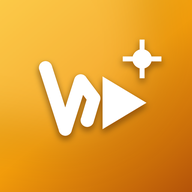

# 🍿 WATZEM — Movies & TV Streaming App

<div align="center">



### The Ultimate Ad-Free Cinema & TV Series Streaming Experience
**Universal Multi-Device Application for Android Mobile, Tablets, Foldables, and Android TV / Google TV**

[](https://github.com/kingpin222/watzem/releases/latest)
[](https://github.com/kingpin222/watzem/releases)
[](https://vuejs.org/)
[](LICENSE)

[**⬇️ Download Latest APK**](https://github.com/kingpin222/watzem/releases/latest/download/app-release.apk) • [**📦 Release Notes**](https://github.com/kingpin222/watzem/releases) • [**✨ Features**](#-key-features) • [**📺 Android TV Guide**](#-android-tv--remote-navigation) • [**🛠️ Development**](#-development--build)

</div>

---

## 📖 Overview

**WATZEM** is an independent, high-performance streaming application powered by **The Movie Database (TMDb)** and a decentralized, multi-source streaming engine. Engineered with a **fluid-first, 100% responsive architecture**, WATZEM adapts dynamically to any screen: from compact mobile phones with notch insets, up to massive 4K Smart TVs with full remote D-Pad navigation.

---

## ✨ Key Features

### 🎬 Comprehensive Catalog & Real-Time Discovery
* **Movies & TV Shows Switcher**: Instant switching between movies and TV series with real-time category updates.
* **Featured Hero Banner**: Dynamic spotlight banners with backdrop imagery, IMDb ratings, genre pills, and one-tap quick play.
* **Explore Directory**:
  * **Genres & Categories**: Action, Sci-Fi, Animation, Horror, Comedy, Crime, Documentary, Drama, Thriller, Romance, and more.
  * **Curated Collections**: Popular sagas, cinematic collections, and thematic showcases.
  * **Top Charts**: Real-time trending titles, all-time highest rated cinema classics, and latest releases.
* **Infinite Scroll**: Continuous smooth loading across all catalog and search results with zero viewport jumps.
* **Instant Search & Trending Suggestions**: Debounced real-time search with trending keyword chips.
* **Local Watchlist & History**: Offline-first bookmarks and watch history stored persistently with progress tracking.

### ⚡ Multi-Source HD Streaming Engine
* **5 Redundant Stream Servers**: Intelligent multi-server switcher (Server 1 to Server 5) with Server 4 preconfigured for ultra-fast playback.
* **TV Series Season & Episode Selector**: Interactive episode drawer with thumbnail previews and watched badges.
* **In-Player Server Selection**: Switch streaming servers directly from the player overlay using touch or TV remote.
* **AdBlocker & Sandbox Protection**: Built-in script sandboxing and ad-pruning filters to shield viewers from popups and malicious redirects.
* **Playback Controls**: Fullscreen theater overlay, playback speed toggles, auto-play next episode, and picture-in-picture support.

### 📺 Android TV & 10-Foot Experience
* **Native TV Leanback Launcher**: Recognizable Android TV banner and home screen launcher intent.
* **Spatial Navigation Engine (`tvSpatialNav`)**:
  * Comprehensive directional D-Pad movement across cards, buttons, drawers, and modal sheets.
  * Active focus highlighting with glowing TV accent borders.
  * Viewport-aware scroll centering (maintains focused items in optimal viewing zones).
  * HTML5 Gamepad API loop supporting Bluetooth gamepads and Android TV remotes.
* **Dedicated TV Sidebar**: Collapsible, fast-access navigation bar for Search, Movies, TV, Explore, Watchlist, and Settings.

### 📱 Responsive Mobile & Tablet Layout
* **Fluid Layout System**: Fluid typography, CSS clamp scaling, and automatic column reflow for any aspect ratio.
* **Safe Area Insets**: Native support for edge-to-edge layouts, status bar translucency, navigation bar styling, and display cutouts.
* **Tactile Haptic Feedback**: Subtle vibration cues on taps, card selects, and actions on supported Android devices.

### 🔄 Over-The-Air (OTA) Updates & In-App Upgrader
* **Built-in In-App Updates**: Dedicated `UpdateView` with direct in-place APK download, real-time byte progress, and one-tap installation.
* **Anonymous Edge Update Architecture**: Cloaked update infrastructure via Cloudflare Worker or GitHub Releases with zero origin server exposure.

### 🤝 Free Community Support & Deep Links
* **Direct App Sharing**: Share movie titles or app download links via WhatsApp, Telegram, X, Facebook, or direct clipboard copy.
* **Community Tips & Monetization**: Decentralized crypto tip addresses with high-resolution QR codes (BTC, ETH, SOL, USDT) and Buy Me a Coffee integration.

---

## 📺 Android TV & Remote Navigation

WATZEM features a dedicated spatial navigation engine designed for remote controls and gamepads:

| Remote / Controller Key | Action |
|:---|:---|
| **D-Pad Up / Down / Left / Right** | Move focus between cards, buttons, and navigation items |
| **D-Pad Center / OK / Enter** | Select item, open detail view, play stream, activate buttons |
| **Back / Escape** | Close player overlay, dismiss dialogs, return to previous page |
| **Play / Pause (Media)** | Toggle video playback directly in the stream player |
| **Gamepad D-Pad / Left Stick** | Full controller navigation supported via HTML5 Gamepad loop |

---

## 📥 Installation

### Method 1: Direct Android Phone / Tablet Install
1. Open your browser and head to [**GitHub Releases**](https://github.com/kingpin222/watzem/releases/latest).
2. Download the latest **`app-release.apk`**.
3. Tap the downloaded APK to install. *(If prompted, allow installation from unknown sources).*
4. Launch **WATZEM** and begin streaming!

### Method 2: Android TV Sideloading
1. Install **Downloader by AFTVnews** from the Google Play Store on your Android TV / Google TV.
2. In the Downloader browser, enter:  
   `https://github.com/kingpin222/watzem/releases/latest/download/app-release.apk`
3. Once downloaded, select **Install**.
4. Open **WATZEM** directly from your TV Apps row.

---

## 🛠️ Development & Build

### Prerequisites
* **Node.js** (v18 or higher) & `npm`
* **Android Studio** & Android SDK (API Level 23 to 34+)
* **Java Development Kit (JDK 17)**

### 1. Clone & Install Dependencies
```bash
git clone https://github.com/kingpin222/watzem.git
cd watzem
npm install
```

### 2. Run Local Development Server
```bash
# Runs frontend Vite dev server and backend proxy concurrently
npm run dev

# Or run frontend only
npm run dev:client
```

### 3. Build & Sync with Android
```bash
# Build frontend web bundle and sync native Capacitor assets
npm run build
npx cap sync android
```

### 4. Build Universal Release APK
WATZEM includes an automated build and release script that bumps version codes, compiles the optimized release APK with Proguard/R8 shrinking, and updates manifests:
```bash
npm run build:apk
```
The compiled APK will be output to:
```
android/app/build/outputs/apk/release/app-release.apk
```

### 5. Launch on Android TV Emulator
```bash
npm run tv:run
```

---

## 🧱 Architecture & Tech Stack

```
watzem/
├── src/
│   ├── components/         # Reusable UI components (Player, FeaturedHero, MovieCard, etc.)
│   ├── views/              # Full page views (Home, Movie, Tv, Explore, Search, Update, Tips)
│   ├── services/           # Core services (tvSpatialNav, tmdb, scraper, torrent)
│   ├── composables/        # Vue composables (useInfiniteScroll, useAppUpdate, useHaptics)
│   ├── styles/             # Global CSS design system, fluid tokens, and tv.css
│   └── App.vue             # Root application shell & routing
├── android/                # Native Android & Android TV Capacitor project
├── update-server/          # Standalone cloaked update server & Cloudflare Worker script
├── scripts/                # Automated APK build, version bump, and release uploader scripts
└── package.json            # Project dependencies and script runner
```

* **Frontend**: [Vue 3](https://vuejs.org/) (Composition API, `<script setup>`), [Vite 6](https://vitejs.dev/), [TypeScript 5](https://www.typescriptlang.org/)
* **Mobile & TV Bridge**: [Capacitor 6](https://capacitorjs.com/) (`@capacitor/android`, `@capacitor/haptics`, `@capacitor/screen-orientation`, `@capacitor/status-bar`)
* **Icons**: [Lucide Vue Next](https://lucide.dev/)
* **Backend Microservice**: Node.js, Express, WebTorrent

---

## ⚖️ Legal Disclaimer

WATZEM is an open-source, non-commercial application created strictly for educational and personal research purposes. 
* WATZEM does not host, upload, or store any video files, media streams, or copyright-protected content on its servers.
* All metadata, titles, descriptions, and release details are retrieved via public APIs provided by [TMDb](https://www.themoviedb.org/).
* All video stream sources are retrieved dynamically from publicly available, third-party internet scrapers and mirrors.
* Please ensure you comply with all local laws and copyright regulations in your jurisdiction.

---

## 💖 Community & Support

WATZEM is maintained with love for cinema enthusiasts around the globe. If you appreciate the app, consider supporting us:
* 🌟 **Star this repository** on GitHub
* 📢 **Share the app** with your friends and movie lovers
* ☕ **Buy us a coffee** or leave a crypto tip via the in-app **Support & Tips** menu

---

<div align="center">
Made with ❤️ by cinema lovers for cinema lovers.
</div>
