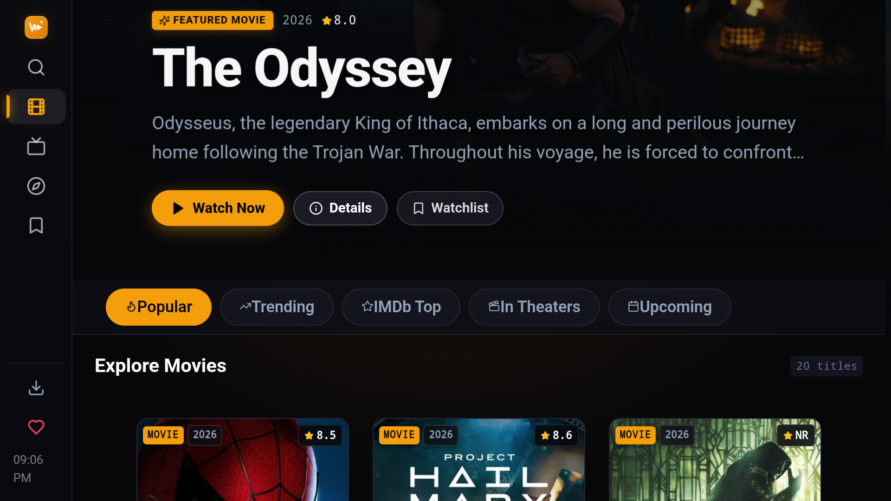
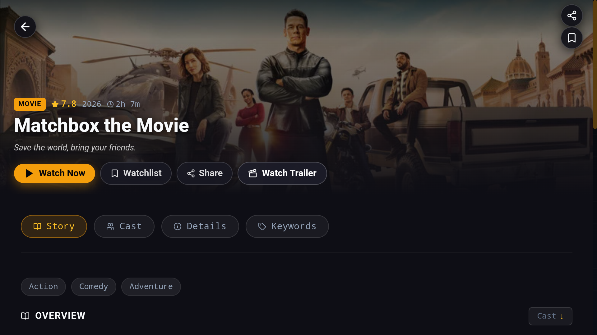

# 🍿 WATZEM — Movies & TV Streaming App

<div align="center">


### The Ultimate Ad-Free Cinema & TV Series Streaming Experience
**Universal Multi-Device Application for Android Mobile, Tablets, Foldables, Android TV / Google TV, macOS, and Web**

[](https://github.com/kingpin222/watzem/releases/latest)
[](https://github.com/kingpin222/watzem/releases)
[](https://developer.android.com/jetpack/compose)
[](LICENSE)

[**⬇️ Download Latest APK (v1.1.300)**](https://github.com/kingpin222/watzem/releases/latest/download/app-release.apk) • [**📦 Release Notes**](https://github.com/kingpin222/watzem/releases) • [**📸 Preview**](#-app-preview) • [**✨ Features**](#-key-features) • [**📺 Android TV Guide**](#-android-tv--remote-navigation) • [**📥 Installation**](#-installation)

</div>

---

## 📖 Overview

**WATZEM** is an independent, high-performance streaming application powered by **The Movie Database (TMDb)** and a decentralized, multi-source streaming engine. Engineered with a **pure native Kotlin & Jetpack Compose architecture** for Android alongside an adaptive **Vue 3 Web & macOS platform**, WATZEM adapts dynamically to any screen: from compact mobile phones with notch insets, up to massive 4K Smart TVs with full remote D-Pad navigation.

---

## 📸 App Preview

<div align="center">


<br/><br/>




</div>

---

## ✨ Key Features

### 🚀 Pure Native Android Performance (Jetpack Compose & ExoPlayer)
* **Native Android Architecture**: Engineered in Kotlin with Jetpack Compose, Material 3 design, and Kotlin Coroutines for fluid 60/120 FPS UI responsiveness.
* **Hardware-Accelerated Playback**: Powered by Google ExoPlayer / Media3 for zero-buffer HLS adaptive bitrate streaming, hardware decoding, and native 1080p / 4K UHD playback.
* **Intuitive Gesture Controls**: Swipe-to-seek, vertical brightness and volume adjustments, and aspect ratio modes (Fit, Zoom, Fill, 16:9).

### 🎬 Comprehensive Catalog & Real-Time Discovery
* **Movies & TV Shows Switcher**: Instant switching between movies and TV series with real-time category updates.
* **Featured Hero Banner**: Dynamic spotlight banners with backdrop imagery, IMDb ratings, genre pills, and one-tap quick play.
* **Explore Directory**:
  * **Genres & Networks**: Action, Sci-Fi, Animation, Horror, Comedy, Crime, Netflix, Disney+, Apple TV+, HBO Max, and more.
  * **Curated Collections**: Popular sagas, cinematic universes, and thematic showcases.
  * **Top Charts**: Real-time trending titles, all-time highest rated cinema classics, and latest theatrical releases.
* **Infinite Scroll**: Continuous smooth loading across all catalog and search results with zero viewport jumps.
* **Instant Search & Trending Suggestions**: Debounced real-time search with trending keyword chips.
* **Offline Watchlist & History**: Offline-first bookmarks and watch progress stored persistently with auto-resume.

### ⚡ Multi-CDN 4K Streaming Engine
* **VIP Streaming Servers**: High-capacity multi-server switcher featuring **CineSrc VIP** and **VidCore 4K** for reliable 1080p and 4K playback.
* **Smart Server Auto-Skip & Fallback**: Automatic server redundancy if a stream is unavailable or buffering.
* **In-Player Server Selection**: Switch streaming servers on-the-fly directly from the player overlay using touch or TV remote.
* **TV Series Season & Episode Selector**: Interactive episode drawer with thumbnail previews, synopsis, and watched badges.
* **AdBlocker & Sandbox Protection**: Built-in script sandboxing and ad-pruning filters to shield viewers from popups, redirects, and third-party trackers.

### 📺 Android TV & 10-Foot Experience
* **Native TV Leanback Launcher**: Recognizable Android TV banner and home screen launcher intent.
* **Spatial Navigation Engine**:
  * Comprehensive directional D-Pad movement across cards, buttons, drawers, and modal sheets.
  * Active focus highlighting with glowing TV accent borders.
  * Viewport-aware scroll centering (maintains focused items in optimal viewing zones).
  * Full support for Bluetooth gamepads, TV remotes, and air mice.
* **Dedicated TV Sidebar**: Collapsible, fast-access navigation bar for Search, Movies, TV, Explore, Watchlist, and Settings.

### 💻 macOS & Multi-Platform Support
* **macOS Desktop Application**: Native macOS bundle (`WATZEM.app`) with launch agent support, background service, and menu bar integration.
* **Universal Deep Linking & Rich Sharing**: Full deep link support (`/watch/movie/:id`, `/watch/tv/:id`) across native Android, macOS, and Web.

### 🔄 Over-The-Air (OTA) Updates & In-App Upgrader
* **Built-in In-App Updates**: Dedicated `UpdateView` with direct in-place APK download, real-time byte progress, and one-tap installation.

---

## 📺 Android TV & Remote Navigation

WATZEM features a dedicated spatial navigation engine designed for remote controls and gamepads:

| Remote / Controller Key | Action |
|:---|:---|
| **D-Pad Up / Down / Left / Right** | Move focus between cards, buttons, and navigation items |
| **D-Pad Center / OK / Enter** | Select item, open detail view, play stream, activate buttons |
| **Back / Escape** | Close player overlay, dismiss dialogs, return to previous page |
| **Play / Pause (Media)** | Toggle video playback directly in the stream player |
| **Gamepad D-Pad / Left Stick** | Full controller navigation supported via HTML5 Gamepad loop |

---

## 📥 Installation

### Method 1: Android Phone, Tablet & Foldable
1. Open your browser and go to [**GitHub Releases**](https://github.com/kingpin222/watzem/releases/latest).
2. Download the latest **`app-release.apk`**.
3. Tap the downloaded APK to install *(allow installation from unknown sources if prompted)*.
4. Launch **WATZEM** and begin streaming!

### Method 2: Android TV / Google TV / Fire TV
1. Install **Downloader by AFTVnews** from the Google Play Store or Amazon Appstore on your TV.
2. In the Downloader browser, enter:  
   `https://github.com/kingpin222/watzem/releases/latest/download/app-release.apk`
3. Once downloaded, select **Install**.
4. Open **WATZEM** directly from your TV Apps row.

### Method 3: macOS Desktop App
1. Clone the repository and run:
   ```bash
   make app
   ```
2. The application will be built, installed to `/Applications/WATZEM.app`, and configured with automated launchd startup.

---

## ⚖️ Legal Disclaimer

WATZEM is an open-source, non-commercial application created strictly for educational and personal research purposes. 
* WATZEM does not host, upload, or store any video files, media streams, or copyright-protected content on its servers.
* All metadata, titles, descriptions, and release details are retrieved via public APIs provided by [TMDb](https://www.themoviedb.org/).
* All video stream sources are retrieved dynamically from publicly available, third-party internet scrapers and mirrors.
* Please ensure you comply with all local laws and copyright regulations in your jurisdiction.

---

## 💖 Community & Support

WATZEM is maintained with love for cinema enthusiasts around the globe. If you appreciate the app, consider supporting us:
* 🌟 **Star this repository** on GitHub
* 📢 **Share the app** with your friends and movie lovers
* ☕ **Buy us a coffee** or leave a crypto tip via the in-app **Support & Tips** menu

---

<div align="center">
Made with ❤️ by cinema lovers for cinema lovers.
</div>
